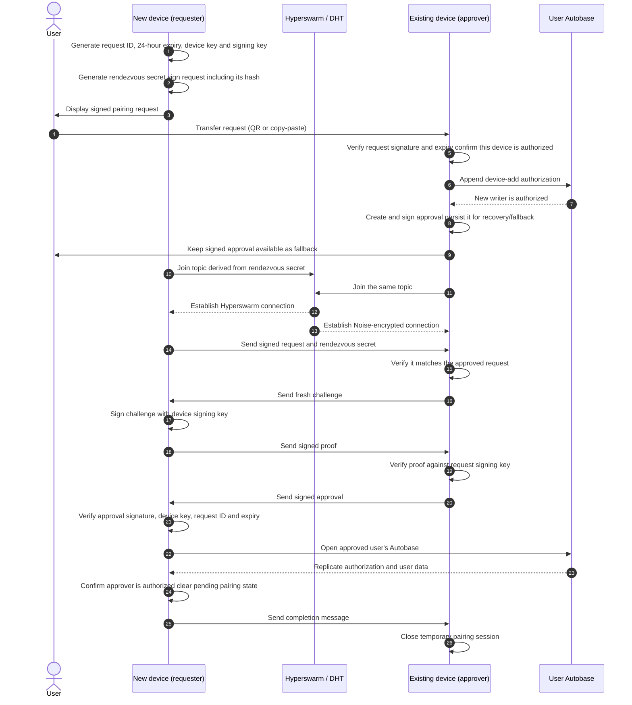

# Architecture notes (`electron/`, `renderer/`, `workers/`)

> Read before editing `electron/`, `renderer/`, or `workers/`, or when debugging
> worker spawn, IPC, or startup crashes. Only non-obvious, code-verified facts —
> the code is the reference for everything else. Index: [AGENTS.md](../AGENTS.md).

Renderer (sandboxed) ↔ `window.bridge` (Electron IPC) ↔ main (broker only) ↔ fd-3
FramedStream pipe ↔ Bare worker (`hello-pear-worker`: swarm + corestore + updater).
The code is small — read it for the wiring; below are only the non-obvious facts.

- The paparam parse at the top of `electron/main.js` throws on **any** unknown flag
  or positional → packaged app crashes at startup. This also makes Win/Linux deep
  links unreachable (a URL in argv kills the process before the single-instance
  lock; only macOS `'open-url'` works).
- The worker specifier `'/workers/main.js'` is the worker's **identity** — embedded
  in every IPC channel name; must start with `/`; `pear:startWorker` resolves any
  renderer-supplied specifier with **no allowlist**.
- Six-arg spawn order (`getWorker()` → worker argv): `updates`, `version`,
  `upgrade`, bundle name (`productName`+ext), storage dir, installed app path.
  Cross-package contract with `hello-pear-worker` — wrong-but-parseable orders fail
  silently. (Worker reads at offset +2 on desktop, 0 on mobile/BareKit; the package
  is shared with `pear-mobile` hosts.)
- The worker is a module for cross-platform reuse (desktop + mobile). For a
  single-platform project, copy `hello-pear-worker/index.js` into
  `workers/main.js` and develop it in-project (per that package's README).
- Once the worker is in-project it resolves against **this** `package.json`, not the
  package's — so Node builtins it uses need an `imports` entry (see AGENTS.md
  contracts). A missing entry only fails in a packaged build.
- Pipe protocol = plain UTF-8 strings in FramedStream frames, matched by exact
  equality. Unknown →worker strings get `console.log`ged; unknown worker→ strings
  are forwarded to the renderer.
- `pear:applyUpdate` is hardwired to `'/workers/main.js'`, lazily respawns a dead
  worker, and its promise has no reject/timeout — any failure = renderer hangs.
- `sendToAll` broadcasts every worker channel to **all** windows; nothing restarts
  a crashed worker.
- Per-platform storage dir is chosen in `getWorker()` (dev:
  `<tmpdir>/pear/HelloPear`). Inside: `pear-runtime/corestore`,
  `pear-runtime/next/<length>.<fork>/` (wiped on every updates-enabled launch),
  `app-storage/` (suggested `pear.storage` for app data).
- The user's nickname, avatar, and joined-language registry are stored in a
  per-user Autobase. `app-storage/user` holds the stable local device keypair;
  the first device keeps its initial user base there, while a paired user's
  base is stored in a separate Corestore at
  `app-storage/user-bases/<user-key>`. The stable writer keypair remains in
  `app-storage/user`, and separate stores prevent named-view collisions without
  changing the paired base's view naming. Each joined-language record includes
  its key and available name, description, and creator metadata, so paired
  devices can show the language list before its language Autobase has
  replicated. `app-storage/registry` keeps the local Autobase key and storage
  selection.
  Pairing requests and approvals are signed and expire after 24 hours. A
  request includes a random rendezvous secret, but only its hash is appended
  to the user Autobase. When both devices are online, Hyperswarm establishes a
  Noise-encrypted connection and sends the signed approval directly. The signed
  copy-paste approval remains available if the devices cannot connect. The
  approver also authorizes the new device's writer in the user Autobase. QR
  scanning and device revocation are not implemented.
- **A stall is usually the network, not the code, and the two look identical.** An
  update that never arrives, or a peer that never connects, most often means this
  machine is unreachable: `pear seed <link> --json` prints `firewalled` and
  `natType`, and `natType: "Random"` is symmetric NAT, which defeats holepunching
  (`upload.totalBytes` then stays 0 however long it runs). Before debugging app
  logic, connect two bare Hyperswarm instances on a random topic with no app code —
  if that fails, nothing above it can work. Exercise real replication against a
  local `hyperdht/testnet` rather than the public DHT.

## Direct device pairing sequence

The request is transferred out of band (for example, as copied JSON). The direct
Hyperswarm connection is used to deliver the approval; the signed approval can
also be copied manually if the devices cannot connect.

